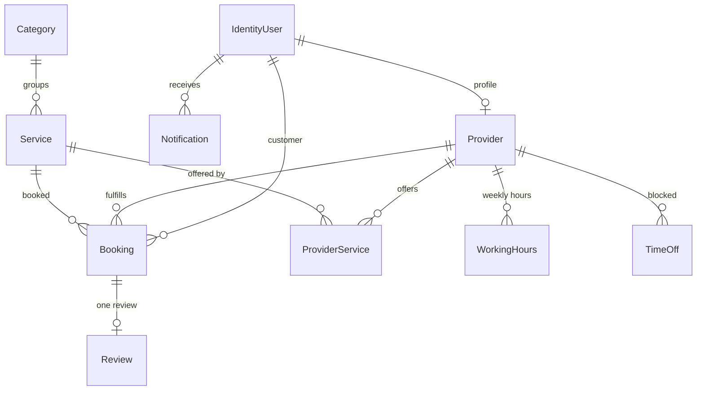

# Day 3 — Booking database design

The relationships in this document are the approved initial design. Category and Service keep their current columns and the existing `Restrict` delete. Identity stays on `AspNetUsers`, `AspNetRoles`, and `AspNetUserRoles`. There are no custom user or role tables.

Application entities reference `IdentityUser` from the dependent side only. `IdentityUser` gets no new navigation properties, so the Identity classes stay unchanged.

`DateTime` values are UTC, matching `CreatedAtUtc` on Category and Service. `TimeOnly` is Asia/Riyadh local time. Collections use the existing `= []` initializer. Required reference navigations use `= null!`, as `Service.Category` does.

No code or migrations are included in this specification.

## ERD



`TaskItem` is the sample feature. It is unchanged and is not part of this model.

## Category

Existing scalar properties. No column changes.

| Property | C# type | Required | Key / navigation |
|---|---|---|---|
| Id | int | yes | PK |
| Name | string | yes | unique, max 100 |
| Description | string? | no | max 500 |
| CreatedAtUtc | DateTime | yes | default `DateTime.UtcNow` |
| Services | `ICollection<Service>` | yes | many Services |

Configured today on `Service`, not on `Category`:

```csharp
builder.HasOne(s => s.Category)
    .WithMany(c => c.Services)
    .HasForeignKey(s => s.CategoryId)
    .OnDelete(DeleteBehavior.Restrict);
```

Each service has one category. A category has zero or more services. Delete is `Restrict`.

## Service

Existing scalar properties stay. Add the three collections below.

| Property | C# type | Required | Key / navigation |
|---|---|---|---|
| Id | int | yes | PK |
| Name | string | yes | max 100 |
| Description | string? | no | max 500 |
| DurationMinutes | int | yes | minimum 1 |
| Price | decimal | yes | precision (18,2), minimum 0 |
| IsActive | bool | yes | default true |
| ImageUrl | string? | no | max 2048 |
| CategoryId | int | yes | FK to Category |
| Category | Category | yes | reference to Category |
| CreatedAtUtc | DateTime | yes | default `DateTime.UtcNow` |
| ProviderServices | `ICollection<ProviderService>` | yes | join rows |
| Providers | `ICollection<Provider>` | yes | skip navigation |
| Bookings | `ICollection<Booking>` | yes | bookings for this service |

The category relationship is unchanged. The provider and booking relationships are configured on Provider and Booking.

## Provider

| Property | C# type | Required | Key / navigation |
|---|---|---|---|
| Id | int | yes | PK |
| UserId | string | yes | FK to `IdentityUser.Id`, unique |
| User | IdentityUser | yes | the one account |
| DisplayName | string | yes | |
| Bio | string? | no | |
| ProviderServices | `ICollection<ProviderService>` | yes | join rows |
| Services | `ICollection<Service>` | yes | skip navigation |
| WorkingHours | `ICollection<WorkingHours>` | yes | weekly rows |
| TimeOff | `ICollection<TimeOff>` | yes | blocked periods |
| Bookings | `ICollection<Booking>` | yes | bookings fulfilled |

`WithOne()` has no navigation on `IdentityUser`. The unique index is the approved zero-or-one profile.

```csharp
builder.HasOne(p => p.User)
    .WithOne()
    .HasForeignKey<Provider>(p => p.UserId)
    .IsRequired()
    .OnDelete(DeleteBehavior.Restrict);

builder.HasIndex(p => p.UserId).IsUnique();

builder.HasMany(p => p.Services)
    .WithMany(s => s.Providers)
    .UsingEntity<ProviderService>(
        right => right.HasOne(ps => ps.Service)
            .WithMany(s => s.ProviderServices)
            .HasForeignKey(ps => ps.ServiceId)
            .OnDelete(DeleteBehavior.Cascade),
        left => left.HasOne(ps => ps.Provider)
            .WithMany(p => p.ProviderServices)
            .HasForeignKey(ps => ps.ProviderId)
            .OnDelete(DeleteBehavior.Cascade),
        join => join.HasKey(ps => new { ps.ProviderId, ps.ServiceId }));
```

Delete of the user is `Restrict`. Delete of either side of the offering removes only the `ProviderService` row (`Cascade`). This configuration is the only many-to-many mapping, so EF does not create a second join table.

## ProviderService

| Property | C# type | Required | Key / navigation |
|---|---|---|---|
| ProviderId | int | yes | PK, FK to Provider |
| ServiceId | int | yes | PK, FK to Service |
| Provider | Provider | yes | reference |
| Service | Service | yes | reference |

No payload columns. The composite key and both cascades are in the Provider configuration above.

## WorkingHours

| Property | C# type | Required | Key / navigation |
|---|---|---|---|
| Id | int | yes | PK |
| ProviderId | int | yes | FK to Provider |
| Provider | Provider | yes | reference |
| DayOfWeek | DayOfWeek | yes | EF stores the enum as int |
| StartTime | TimeOnly | yes | local time |
| EndTime | TimeOnly | yes | local time |

```csharp
builder.HasOne(w => w.Provider)
    .WithMany(p => p.WorkingHours)
    .HasForeignKey(w => w.ProviderId)
    .IsRequired()
    .OnDelete(DeleteBehavior.Cascade);
```

One provider has many rows. There is no unique `(ProviderId, DayOfWeek)` index, because the guide does not limit a day to one interval. Deleting the provider deletes these rows.

## TimeOff

| Property | C# type | Required | Key / navigation |
|---|---|---|---|
| Id | int | yes | PK |
| ProviderId | int | yes | FK to Provider |
| Provider | Provider | yes | reference |
| StartUtc | DateTime | yes | UTC |
| EndUtc | DateTime | yes | UTC |
| Reason | string? | no | |

```csharp
builder.HasOne(t => t.Provider)
    .WithMany(p => p.TimeOff)
    .HasForeignKey(t => t.ProviderId)
    .IsRequired()
    .OnDelete(DeleteBehavior.Cascade);
```

Deleting the provider deletes these rows.

## Booking

| Property | C# type | Required | Key / navigation |
|---|---|---|---|
| Id | int | yes | PK |
| CustomerId | string | yes | FK to `IdentityUser.Id` |
| Customer | IdentityUser | yes | the customer account |
| ProviderId | int | yes | FK to Provider |
| Provider | Provider | yes | reference |
| ServiceId | int | yes | FK to Service |
| Service | Service | yes | reference |
| StartUtc | DateTime | yes | UTC |
| EndUtc | DateTime | yes | UTC, start plus the service duration at booking time |
| Status | BookingStatus | yes | Pending, Confirmed, Completed, Cancelled, NoShow |
| PriceAtBooking | decimal | yes | precision (18,2), copy of `Service.Price` |
| Notes | string? | no | |
| RowVersion | byte[] | yes | concurrency token |
| Review | Review? | no | the one review, when it exists |

`WithMany()` adds no booking collection to `IdentityUser`.

```csharp
builder.HasOne(b => b.Customer)
    .WithMany()
    .HasForeignKey(b => b.CustomerId)
    .IsRequired()
    .OnDelete(DeleteBehavior.Restrict);

builder.HasOne(b => b.Provider)
    .WithMany(p => p.Bookings)
    .HasForeignKey(b => b.ProviderId)
    .IsRequired()
    .OnDelete(DeleteBehavior.Restrict);

builder.HasOne(b => b.Service)
    .WithMany(s => s.Bookings)
    .HasForeignKey(b => b.ServiceId)
    .IsRequired()
    .OnDelete(DeleteBehavior.Restrict);

builder.Property(b => b.PriceAtBooking).HasPrecision(18, 2);
builder.Property(b => b.RowVersion).IsRowVersion();
```

Customer, provider, and service deletes are `Restrict`, so a booking keeps the three required references and `PriceAtBooking`. The review relationship is configured on Review.

These rules use the columns above and add no further booking columns:

- Overlap for one provider uses `ProviderId`, `StartUtc`, `EndUtc`, and `RowVersion`.
- Working hours and time off are the related rows, compared with the booking interval.
- The provider offers the service through `ProviderService`, and the service must be `IsActive`.
- The 2-hour minimum and 60-day maximum are checks against `StartUtc`.
- The 24-hour cancel and reschedule limit is a check against `StartUtc`. Reschedule updates the same row.
- `PriceAtBooking` preserves the price.
- UTC storage needs no timezone column. Display is Asia/Riyadh.
- One review of a `Completed` booking is `Review.BookingId` unique plus `Status`.
- Visibility uses `CustomerId`, the provider's user, and Identity roles.

Overlap is a transaction rule. `RowVersion` is the concurrency token. There is no unique index on the time range.

## Review

| Property | C# type | Required | Key / navigation |
|---|---|---|---|
| Id | int | yes | PK |
| BookingId | int | yes | FK to Booking, unique |
| Booking | Booking | yes | reference |
| Rating | int | yes | 1 through 5, enforced in application validation |
| Comment | string? | no | |

```csharp
builder.HasOne(r => r.Booking)
    .WithOne(b => b.Review)
    .HasForeignKey<Review>(r => r.BookingId)
    .IsRequired()
    .OnDelete(DeleteBehavior.Cascade);

builder.HasIndex(r => r.BookingId).IsUnique();
```

A booking has zero or one review. Deleting the booking deletes the review. The unique index is the one-review rule. The completed-status rule stays in application code.

## Notification

| Property | C# type | Required | Key / navigation |
|---|---|---|---|
| Id | int | yes | PK |
| UserId | string | yes | FK to `IdentityUser.Id` |
| User | IdentityUser | yes | recipient |
| Title | string | yes | |
| Body | string | yes | |
| IsRead | bool | yes | default false |
| CreatedAtUtc | DateTime | yes | default `DateTime.UtcNow` |

```csharp
builder.HasOne(n => n.User)
    .WithMany()
    .HasForeignKey(n => n.UserId)
    .IsRequired()
    .OnDelete(DeleteBehavior.Cascade);
```

Deleting the user deletes that user's notifications. The guide's field list has no booking foreign key.

## Identity

`IdentityUser`, `IdentityRole`, and `IdentityUserRole` keep Identity's schema and Identity's cascade from user and role onto `AspNetUserRoles`. The booking model does not configure those tables and does not add claims, logins, or token entities.

The foreign keys above require Identity's user table in the same model. `AppDbContext` is still a plain `DbContext`.

## Needs confirmation

1. Day 3 seeds providers, and Identity is week 2. `Provider.UserId` is required in this specification. Confirm the foreign key is created when Identity joins the model, and that linking the seeded providers happens then.
2. The guide does not say whether `Cancelled` or `NoShow` still occupies the slot. No extra column either way.
3. The guide does not list each allowed edge into `Cancelled` or `NoShow`, or whether reschedule changes `Status`. The stored field stays `Status`.
4. `BookingStatus` has no storage format in the guide. EF Core stores an enum as `int` unless a conversion is added. `DayOfWeek` uses that same default.
5. Lengths for the new strings are not in the guide. Proposed limits, matching the current entities, are 100 for `DisplayName`, 500 for `Bio` and `Reason`, 200 for `Title`, and 2000 for `Notes`, `Comment`, and `Body`.
6. `Bio`, `Reason`, `Notes`, and `Comment` are optional here because Category and Service descriptions are optional. The guide lists the fields and does not say they may be empty.
